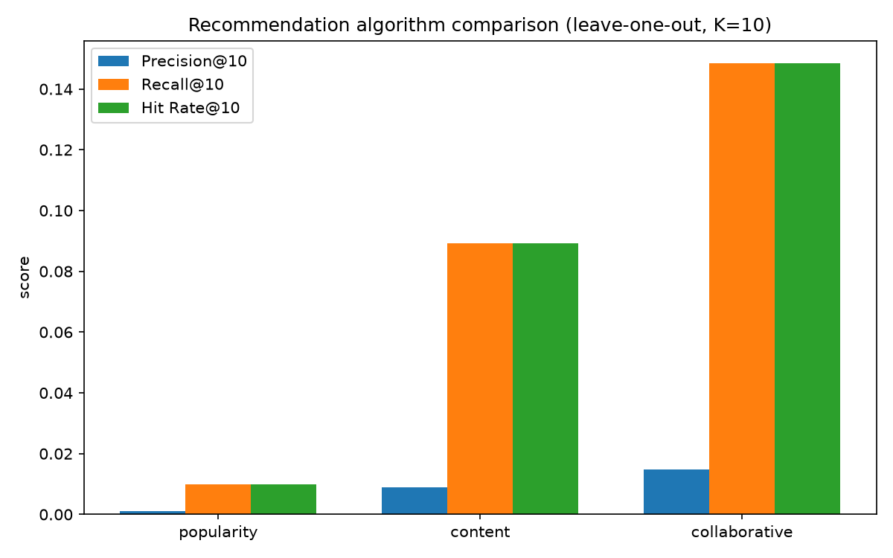

# Evaluation

Offline comparison of the three recommendation algorithms (popularity, content-based,
collaborative). The output — a metrics table and chart — feeds the thesis's experiments chapter,
so this phase runs **in parallel with (or before) writing the thesis**.

Lives entirely in the recommender project: `src/rapsodium_recommender/evaluation/` (logic) and
`poetry run evaluate` (CLI).

---

## Protocol — leave-one-out (LOO)

For every user we hold out **one positive song** — by default their most-recently **saved**
track — as the ground-truth relevant item, train each algorithm on everything else, then check
whether the held-out song appears in that user's top-K recommendations.

Key choices:

- **Remove the whole (user, song) pair**, not just the held-out save. If the user also *played*
  that song, leaving the play in the training set would keep the song "seen", and every
  recommender excludes seen songs — so it could never be surfaced and would be a guaranteed
  miss. Removing all of the user's rows for that song fixes this.
- **Full-catalogue ranking** (the "all-unrated items" protocol): recommenders rank the whole
  catalogue minus seen songs. No negative sampling — a harder, more honest setup than ranking
  the positive against a handful of sampled negatives.
- **The contextual ("vibe") recommender is excluded.** It ranks toward a chat-derived
  `VibeProfile`, not past behaviour, so there's no offline ground truth without simulating
  conversations.

The split (`select_holdouts`, `make_training_set`) and metrics are **pure functions** over
DataFrames, unit-tested in `tests/test_evaluation.py` with no database.

---

## Metrics @K (default K = 10)

| Metric | Meaning |
| --- | --- |
| **Precision@K** | fraction of the top-K that are relevant |
| **Recall@K** | fraction of relevant items found in the top-K |
| **Hit Rate@K** | 1 if the held-out song is in the top-K, else 0 (averaged over users) |

> **Note.** With exactly one held-out item per user these collapse to:
> `Recall@K == Hit Rate@K` and `Precision@K == Hit Rate@K / K`. So **Hit Rate@K is the headline
> number**; Precision/Recall are reported for completeness (the roadmap asks for all three).
> Holding out multiple positives per user (e.g. `--positive-events save,play`) makes Precision
> and Recall independently meaningful.

The harness also reports `users_evaluated` (had a held-out positive) and `users_with_recs`
(algorithm returned a non-empty list — exposes cold-start coverage, e.g. content-based returns
nothing for a user whose only save was the held-out one).

---

## Running it

```bash
cd recommender
poetry run evaluate                              # K=10, all baselines, table to stdout
poetry run evaluate --k 10 --csv results.csv     # also write the results table as CSV
poetry run evaluate --csv results.csv --chart results.png   # grouped bar chart (needs matplotlib)
poetry run evaluate --algorithms popularity,content
poetry run evaluate --positive-events save,play  # broaden what counts as relevant
```

Reads `interactions` and `songs` straight from Postgres (same `data.py` loader the live service
and `leaderboard` use), so it reflects whatever the seed/synthetic data contains.

Charts use **matplotlib**, kept optional to avoid weighing down the runtime install. If it's not
present, `--chart` prints an install hint (`poetry add --group dev matplotlib`); the table and
`--csv` work without it.

---

## Results

Run on the full synthetic dataset (100 users, ~5.5k interactions, 491 songs with **real**
audio features extracted from Deezer previews via Essentia). Reproducible — seed
`rapsodium-eval`, `K=10`, positives = `save`:

| Algorithm | Precision@10 | Recall@10 | Hit Rate@10 |
| --- | --- | --- | --- |
| popularity (baseline) | 0.0010 | 0.0099 | **0.99%** |
| content-based | 0.0089 | 0.0891 | **8.91%** |
| collaborative | 0.0149 | 0.1485 | **14.85%** |



**Analysis.**

- Both personalized algorithms beat the non-personalized popularity baseline by a wide margin
  (~9× for content, ~15× for collaborative) — the expected and desired ordering.
- **Collaborative filtering wins.** The synthetic data has users with overlapping genre/taste
  profiles, so item co-occurrence is a strong signal; CF exploits it directly.
- **Content-based is solid but lower**, limited by ranking purely on audio-feature + genre
  similarity to the user's remaining saves — it can't benefit from crowd co-occurrence.
- Popularity recommends the same global top songs to everyone, so it only "hits" when a user's
  held-out save happens to be a globally popular track — rare, hence ~1%.

Recall@10 == Hit Rate@10 and Precision@10 == Hit Rate@10 / 10, as expected for single-item LOO
(see the metric note above). All 100 synthetic users (plus one residual real account = 101
evaluated) had a held-out save and received recommendations from every algorithm.

Regenerate with:

```bash
cd recommender && poetry run evaluate --csv results.csv      # add --chart results.png for the bar chart
```
